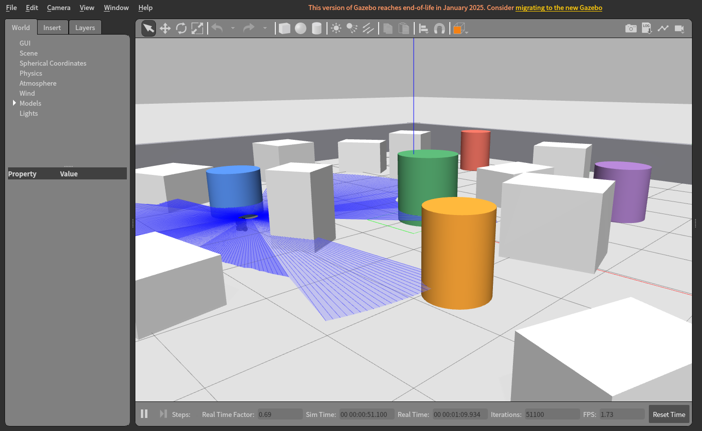
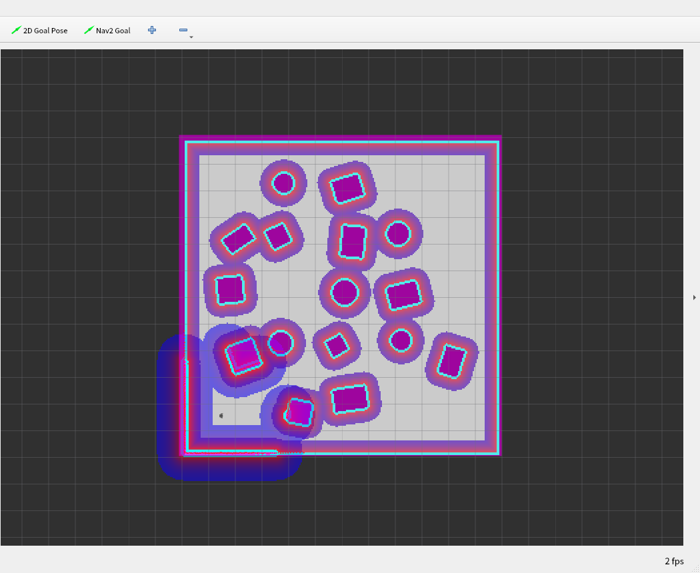
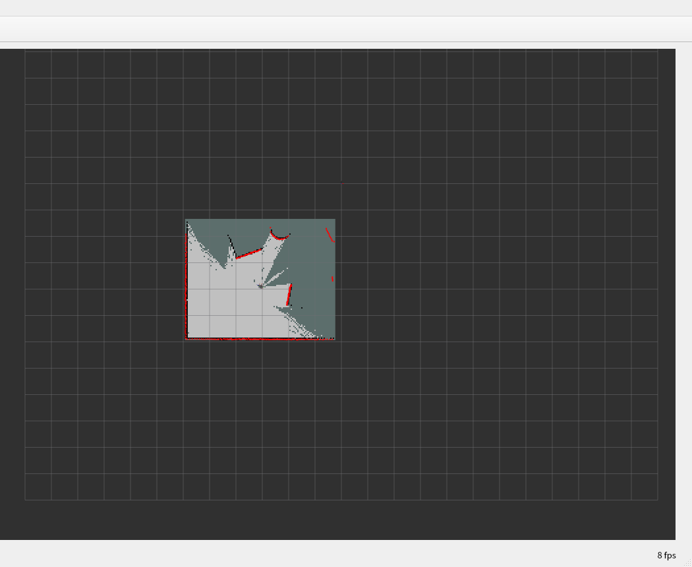
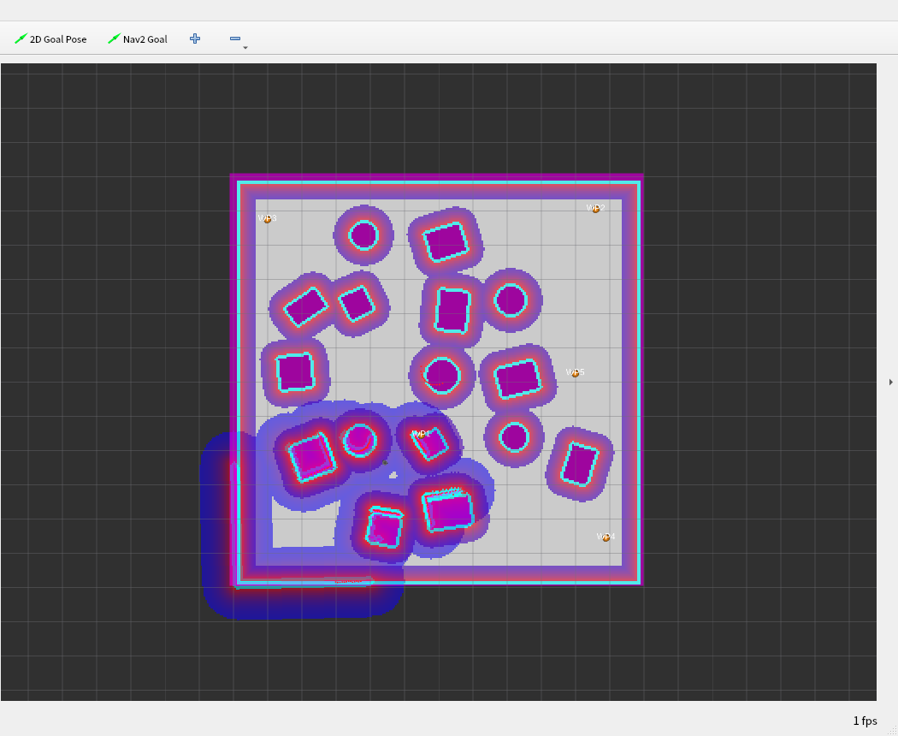
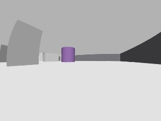
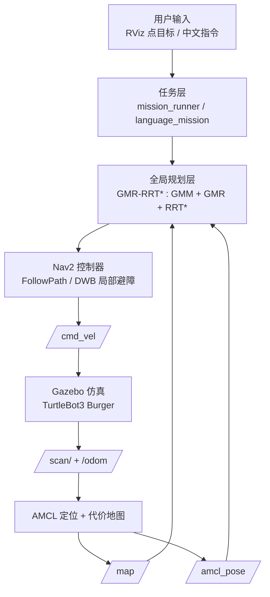

<div align="center">

# GMR-RRT* 小车导航仿真

**ROS 2 Humble + Gazebo Classic + TurtleBot3 的移动机器人导航全链路**

[](https://docs.ros.org/en/humble/)
[](https://classic.gazebosim.org/)
[](https://releases.ubuntu.com/22.04/)
[](https://www.python.org/)
[](LICENSE)

</div>

---

## 项目简介

本项目在 **ROS 2 Humble + Gazebo Classic 11** 仿真环境中，使用 **TurtleBot3 Burger** 完成移动机器人导航的完整闭环：从 SLAM 自主建图，到航点巡逻，再到接入自研全局规划器的点对点导航与自然语言任务。

全局规划部分复现了 IEEE T-IV 2022 论文 **《GMR-RRT\*: Sampling-Based Path Planning with Gaussian Mixture Regression》** 的核心方法：用高斯混合模型（GMM）拟合演示轨迹，用高斯混合回归（GMR）在给定时间点预测路径分布，再把该分布作为 RRT\* 的条件采样先验，从而把采样集中在"像人开的路线"上。

> **声明**：GMR-RRT\* 算法由原论文作者提出，本项目为**学习复现与工程集成**，不主张算法原创性。代码中的 `gmr_lib/` 对应论文 Section III 与 Algorithm 1–2，`car_nav/` 中的节点负责与 Nav2、Gazebo、RViz 的工程对接。

## 演示效果

<table>
<tr>
<td width="50%"><br><sub>Gazebo 中的障碍场与 TurtleBot3 Burger</sub></td>
<td width="50%"><br><sub>RViz 中的全局代价地图与规划结果</sub></td>
</tr>
<tr>
<td><br><sub>slam_toolbox 在线建图，边界随探索扩张</sub></td>
<td><br><sub>航点巡逻任务与代价地图膨胀层</sub></td>
</tr>
</table>

<p align="center">

<br><sub>任务到达后相机抓拍，供视觉问答使用</sub>
</p>

## 目录

- [功能特性](#功能特性)
- [系统架构](#系统架构)
- [目录结构](#目录结构)
- [环境依赖](#环境依赖)
- [快速开始](#快速开始)
- [算法说明](#算法说明)
- [话题与接口](#话题与接口)
- [常见问题](#常见问题)
- [引用](#引用)
- [许可证](#许可证)

## 功能特性

| 模块 | 可执行文件 | 说明 |
|---|---|---|
| SLAM 自主建图 | `frontier_explore` / `roadmap_exploration_server` | 基于 roadmap_explorer + Nav2 的自主探索，按参考地图覆盖率自动停止并保存地图 |
| 航点巡逻 | `mission_runner` | 用 `nav2_simple_commander` 依次前往多个航点，可跨房间 |
| GMR-RRT\* 规划 | `gmr_planner_node` | 读 `/map` 与 `/amcl_pose`，生成 GMM→GMR→RRT\* 路径，交给 Nav2 `FollowPath` 执行 |
| A\* 规划 | `astar_planner` | 独立栅格 A\* 实现，用于离线对比与调试 |
| 自然语言任务 | `language_mission` | 解析中文指令 → 查语义地图 → 导航 → 相机抓拍 → 视觉问答，任务日志落盘 |
| 位姿初始化 | `initial_pose_publisher` | 启动时把 AMCL 初始位姿对齐到 Gazebo 出生点，避免定位漂移 |
| 目标下发 | `goal_client` | 命令行发送 `NavigateToPose` 目标 |
| 指令图形界面 | `language_gui` | Tkinter 窗口，输入中文指令后发到 `/language/command`，并实时显示任务日志 |

## 系统架构



三层职责划分：

| 层 | 负责 | 不负责 |
|---|---|---|
| 任务层 | 决定"去哪里、按什么顺序去" | 具体路径长什么样 |
| 全局规划层 | 决定"几何上走哪条路最优" | 怎么打方向盘 |
| 局部控制层 | 决定"每一时刻的速度指令" | 全局路线选择 |

## 目录结构

```
car_ws/
├── .gitignore
└── src/
    └── car_nav/                    ROS 2 功能包
        ├── car_nav/                Python 源码
        │   ├── gmr_lib/            算法核心（不依赖 ROS，可单独运行）
        │   │   ├── gmr.py            GMM 拟合 + GMR 回归 + 三种采样器
        │   │   ├── rrt_star.py       RRT* 骨架（论文 Algorithm 1 + 2）
        │   │   ├── map_env.py        栅格环境封装
        │   │   └── demos.py          演示轨迹合成
        │   ├── gmr_planner_node.py   ROS 2 规划节点（算法接入导航）
        │   ├── frontier_explore.py   前沿自主探索
        │   ├── mission_runner.py     航点巡逻
        │   ├── language_mission_node.py  自然语言任务
        │   ├── astar_planner.py      A* 规划器
        │   ├── grid_env.py           栅格工具
        │   └── ...
        ├── config/                 Nav2 参数、语义地图、SLAM 参数
        ├── launch/                 三个启动文件
        ├── maps/                   栅格地图（.pgm + .yaml）
        ├── rviz/                   RViz 配置
        ├── scripts/                一键演示脚本（demo1–4）
        ├── tests/                  建图与航点挑选工具
        └── worlds/                 Gazebo 世界文件
```

## 环境依赖

| 组件 | 版本 | 说明 |
|---|---|---|
| 操作系统 | Ubuntu 22.04 | 与 ROS 2 Humble 对应 |
| ROS 2 | Humble | 必须 |
| Gazebo | Classic 11.10 | TurtleBot3 官方模型依赖 |
| 机器人模型 | TurtleBot3 Burger | `export TURTLEBOT3_MODEL=burger` |
| 导航 | Nav2 | `nav2_bringup`、`nav2_simple_commander` |
| SLAM | slam_toolbox | 在线异步建图 |
| 自主探索 | roadmap_explorer | 前沿 + roadmap 目标排序，需源码构建，见 [演示 1 说明](docs/demo1-autonomous-exploration.md) |
| Python | 3.10 | numpy、scikit-learn、opencv、pyyaml |

安装依赖：

```bash
sudo apt update
sudo apt install -y \
  ros-humble-navigation2 ros-humble-nav2-bringup \
  ros-humble-turtlebot3 ros-humble-turtlebot3-gazebo \
  ros-humble-turtlebot3-navigation2 ros-humble-turtlebot3-teleop \
  ros-humble-slam-toolbox ros-humble-gazebo-ros-pkgs \
  ros-humble-cv-bridge

echo "export TURTLEBOT3_MODEL=burger" >> ~/.bashrc
```

> Gazebo 模型第一次启动会自动下载；国内网络建议提前把 `turtlebot3_gazebo/models` 放入 `~/.gazebo/models`。

## 快速开始

```bash
git clone git@github.com:huiyeyue2/gmr-rrt-car-nav.git
cd gmr-rrt-car-nav
colcon build --symlink-install
source install/setup.bash
```

四个演示（每个都在**独立终端**中运行，启动脚本内部已 source 好环境）：

| 演示 | 命令 | 内容 |
|---|---|---|
| 1. SLAM 建图 | `bash src/car_nav/scripts/run_demo1_roadmap.sh` | roadmap_explorer + Nav2 自主探索，覆盖率达到 95% 自动保存地图 |
| 2. 航点导航 | `bash src/car_nav/scripts/run_demo2_mission.sh` | 加载静态地图，依次前往 4–5 个航点 |
| 3. GMR-RRT\* | `bash src/car_nav/scripts/run_demo3_gmrrrt.sh` | 启动导航后用 RViz 点目标，走算法路径 |
| 4. 自然语言 | `bash src/car_nav/scripts/run_demo4_language.sh` | 终端输入中文指令，机器人前往并观察 |

> 演示 1 的完整方案（组件职责、覆盖率判据、停滞恢复机制、实测数据）见 [docs/demo1-autonomous-exploration.md](docs/demo1-autonomous-exploration.md)。

也可直接使用 launch 文件：

```bash
# 手动点目标（RViz 的 "2D Goal Pose"）
ros2 launch car_nav nav_demo.launch.py

# 自动航点巡逻
ros2 launch car_nav nav_demo.launch.py run_mission:=true

# 房屋场景（需先建好 house 地图）
ros2 launch car_nav nav_demo.launch.py scene:=house run_mission:=true
```

**停止全部进程**（每次启动新演示前务必执行，否则旧进程会抢话题）：

```bash
pkill -9 -f "ros2 launch"; pkill -9 -f gzserver; pkill -9 -f gzclient; \
pkill -9 -f rviz2; pkill -9 -f slam_toolbox; pkill -9 -f frontier_explore
```

### 单独跑算法规划

```bash
# 带 NavFn 对比（RViz 里会同时显示两条路径）
ros2 run car_nav gmr_planner_node --ros-args -p use_sim_time:=true -p compare_navfn:=true
```

在 RViz 中用 `GMR Goal` 工具下发目标到 `/gmr/goal_pose`。

> 不要用 `/goal_pose`：Humble 的 `bt_navigator` 也订阅该话题，会同时触发标准 NavFn 导航，与 `FollowPath` 争抢 `/cmd_vel`。

## 算法说明

### 四个步骤

1. **演示轨迹合成**：从栅格地图上用 A\* 生成多条"绕障平滑"的参考轨迹 `demos.py`
2. **GMM 拟合**：把每条轨迹按时间展开成 `[t, x, y]`，拟合 K=8 分量的联合高斯混合（论文式 1–2）
3. **GMR 回归**：给定时间 t，按式(5) 算各分量责任度，按式(6) 加权合并出条件均值与协方差
4. **RRT\* 采样**：先用 GMR 预测的分布生成条件采样点（Algorithm 2），失败时才退回均匀采样

### 三种采样器（可插拔）

RRT\* 主干代码只有一份，三个算法共用，**唯一差异是采样器**：

| 采样器 | 采样方式 | 对应算法 |
|---|---|---|
| `UniformSampler` | 全图均匀随机 | 标准 RRT\* |
| `GMMSampler` | 从联合 GMM 边缘分布采样 | GMM-RRT\* |
| `GMRSampler` | 50% 均匀 + 50% 条件高斯（GMR 预测） | **GMR-RRT\*** |

这样做保证对比公平：树结构、重连、代价计算完全相同。

### 关键参数（与论文一致）

| 参数 | 值 | 位置 |
|---|---|---|
| GMM 分量数 K | 8 | `gmr_lib/gmr.py` |
| 步长 step size | 6 | `gmr_lib/rrt_star.py` |
| 重连半径 rewire radius | 35 | `gmr_lib/rrt_star.py` |
| 目标判定半径 goal radius | 14 | `gmr_lib/rrt_star.py` |
| 最大迭代 | 2000 | `gmr_lib/rrt_star.py` |

## 话题与接口

### GMR 规划节点

| 话题 | 类型 | 方向 | 说明 |
|---|---|---|---|
| `/map` | `nav_msgs/OccupancyGrid` | 订阅 | 静态地图 |
| `/amcl_pose` | `PoseWithCovarianceStamped` | 订阅 | 当前位姿（起点） |
| `/gmr/goal_pose` | `geometry_msgs/PoseStamped` | 订阅 | 本节点专用目标 |
| `/gmr/path` | `nav_msgs/Path` | 发布 | 最终路径 |
| `/gmr/tree` | `visualization_msgs/MarkerArray` | 发布 | 搜索树 |
| `/gmr/demos` | `visualization_msgs/MarkerArray` | 发布 | 演示轨迹与 GMR 分布 |
| `/gmr/navfn_path` | `nav_msgs/Path` | 发布 | NavFn 对比路径 |

### 自然语言任务

| 话题 | 类型 | 说明 |
|---|---|---|
| `/language/command` | `std_msgs/String` | 下发中文指令 |

```bash
ros2 topic pub --once /language/command std_msgs/msg/String "{data: '去货架B观察一下'}"
```

图形界面：另开终端执行 `ros2 run car_nav language_gui`，窗口中输入中文指令、点快捷按钮即可，日志区实时显示任务输出。

未配置大模型 API 时自动退回规则解析，不影响演示。

## 常见问题

**Q1：`ros2 launch` 起来后车不动**

按顺序排查：`ros2 topic echo /clock --once` 有没有输出 → `ros2 topic info /map` 的 Publisher count 是否为 1 → `ros2 run tf2_ros tf2_echo map base_footprint` 是否打印位移。哪一步断了问题就在那里。最常见原因是上一轮进程没杀干净。

另一个隐蔽原因：残留的 `static_transform_publisher` 在发固定的 `map → base_link`，会和 slam_toolbox 的 `map → odom` 冲突，表现为"地图看着正常但车一步不动"，此时 `tf2_echo map base_link` 会报外推错误。启动脚本已把它纳入清理范围。

**Q2：AMCL 定位飘到原点**

`mission_runner` 内部会调 `waitUntilNav2Active()`，这一步可能把位姿重置。启动时必须先执行 `initial_pose_publisher`，且其 `initial_x/initial_y` 与 Gazebo 出生点一致。

**Q3：`map_saver_cli` 保存失败**

参数顺序有坑，`-f` 必须在 `--ros-args -p` 之前：

```bash
ros2 run nav2_map_server map_saver_cli -f ./maps/xxx --ros-args -p save_map_timeout:=15.0
```

反了会直接 `exit 255` 并报 `Wrong argument: -p`。

**Q4：构建后行为没变化**

本包用 `--symlink-install`，改 Python 源码通常立即生效。若改的是 `setup.py`、`package.xml` 或 launch 入口点，必须重新 `colcon build`。

## 引用

如果本项目对你的工作有帮助，请引用原论文：

```bibtex
@article{gmr_rrt_star_2022,
  title     = {GMR-RRT*: Sampling-Based Path Planning with Gaussian Mixture Regression},
  journal   = {IEEE Transactions on Intelligent Vehicles},
  year      = {2022}
}
```

## 许可证

本项目代码采用 [Apache License 2.0](LICENSE)。

TurtleBot3、Nav2、slam_toolbox 等第三方组件遵循其各自的许可证。

## 致谢

- 算法思路来自 GMR-RRT\* 原论文作者
- 仿真环境基于 [TurtleBot3](https://github.com/ROBOTIS-GIT/turtlebot3) 与 [Nav2](https://github.com/ros-navigation/navigation2) 开源项目
