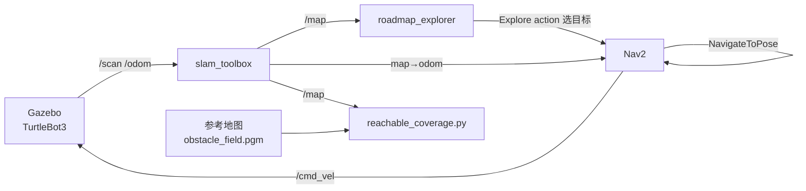

# 演示 1：基于 roadmap_explorer 的自主探索建图

> 适用环境：ROS 2 Humble + Gazebo Classic 11 + TurtleBot3 Burger
> 实测结果：参考地图自由空间覆盖率 **96.49%**，达到阈值后自动停止并保存地图

## 1. 为什么换掉手写 frontier 方案

早期版本用 `frontier_explore.py` 直接向 `/cmd_vel` 发速度：自己找前沿、自己算信息增益、自己避障。

实测暴露出三个问题：

| 问题 | 原因 |
|---|---|
| 贴着障碍物左右摇摆 | 避障只做"原地转一下再冲"，解除条件过松 |
| 反复绕着柱子转圈 | 用前沿簇的格子数当增益，柱子周围长边界被误判为高价值 |
| 会撞到柱子 | 只检查正前方激光扇区，斜前方障碍漏检 |

根因是**没有全局路径规划**：所有决策都压缩在一个速度控制节点里，没有任何一层知道"从当前位置到目标点该怎么走"。

新方案把职责拆开：**选目标**交给 roadmap_explorer，**走路**交给 Nav2。

## 2. 系统组成

| 组件 | 职责 |
|---|---|
| `slam_toolbox`（online async） | 在线建图，发布 `/map` 与 `map → odom` |
| `roadmap_explorer` | 依据地图构建 roadmap、提取前沿、排序并选出下一个探索目标 |
| `Nav2`（NavFn + DWB） | 全局路径规划 + 局部避障，输出 `/cmd_vel` |
| `run_demo1_roadmap.sh` | 启动编排、覆盖率判定、停滞续跑、保存地图 |
| `reachable_coverage.py` | 按参考地图计算真实自由空间覆盖率 |

数据流：



`roadmap_explorer` 上游项目：[suchetanrs/roadmap-explorer](https://github.com/suchetanrs/roadmap-explorer)。

## 3. roadmap_explorer 的工作方式

1. 从 `/map` 构建可通行 roadmap 图
2. 在图边界提取前沿（已知自由与未知的交界）
3. 按路径代价 + 信息增益排序（TSP 式全局排序）
4. 通过 action `/roadmap_explorer` 下发目标，交给 Nav2 执行

action 类型：`roadmap_explorer_msgs/action/Explore`

| `exploration_bringup_mode` | 含义 |
|---|---|
| `0` | 新建探索会话 |
| `1` | 续跑已有会话（进程中断后恢复用） |

参数文件：`src/car_nav/config/roadmap_obstacle_field.yaml`

> 注意：roadmap_explorer 在本项目中必须使用 **CycloneDDS**（`RMW_IMPLEMENTATION=rmw_cyclonedds_cpp`）。FastDDS 下曾出现段错误。

## 4. 覆盖率判据（关键改动）

旧脚本把"界内自由 / (界内自由 + 界内未知)"当作覆盖率，但分母里混进了**永远不可能探索到**的未知格：

- 墙体内部、柱子内部
- 障碍物背面被遮挡的区域
- 场地边界以外的格子

结果是覆盖率永远到不了 95%，停止条件形同虚设。

新判据使用**参考地图** `src/car_nav/maps/obstacle_field.pgm`：

```
coverage = 已覆盖的参考自由格 / 参考地图真实自由格总数
```

- 统计范围：场地内 `|x| ≤ 5.8 m`、`|y| ≤ 5.8 m`
- 分子：参考地图中为自由、且在 SLAM 地图中也已变为自由的格子
- 分母：参考地图中该范围内的全部真实自由格

参考地图**只用于评估**，不参与建图、不参与导航，不影响探索过程。

## 5. 启动自检与停滞恢复

启动前清理（缺一不可）：

- 旧 `ros2 launch`、旧 Explore action
- `gzserver` / `gzclient`
- `rviz2`、`async_slam_toolbox_node`、`controller_server`
- **`static_transform_publisher`**：遗留的静态 `map → base_link` 会和 slam 的 `map → odom` 冲突，导致 TF 树被污染，表现为"地图正常但车一步不动"

启动后自检：`/clock` 与 `/scan` 必须有数据，否则直接判定无效启动并退出，避免空转等待。

运行中的三类停滞信号，任一命中即取消当前目标并续跑（最多 8 次）：

| 信号 | 判据 |
|---|---|
| 无可用前沿 | 日志出现 `no achievable frontiers left` |
| 搜索半径内无前沿 | 日志出现 `no frontiers in current search radius` |
| 地图不再更新 | 保存的 PGM 连续 4 次检查（120 秒）MD5 不变 |

达到目标覆盖率后：保存正式地图 → 退出码 0。

## 6. 运行方法

### 6.1 依赖

```bash
# 基础依赖
sudo apt install -y ros-humble-navigation2 ros-humble-nav2-bringup \
  ros-humble-turtlebot3-gazebo ros-humble-slam-toolbox \
  ros-humble-cyclonedds ros-humble-rmw-cyclonedds-cpp

# roadmap_explorer（需从源码构建）
mkdir -p ~/roadmap_ws/src && cd ~/roadmap_ws/src
git clone https://github.com/suchetanrs/roadmap-explorer.git
cd ~/roadmap_ws && colcon build
```

### 6.2 启动

```bash
cd car_ws
colcon build --symlink-install
source install/setup.bash

# 参数：最长运行秒数（默认 1200）
bash src/car_nav/scripts/run_demo1_roadmap.sh 1200
```

可调环境变量：

| 变量 | 默认值 | 说明 |
|---|---|---|
| `TARGET_COVERAGE` | `0.95` | 目标覆盖率 |
| `CHECK_INTERVAL` | `30` | 覆盖率检查周期（秒） |
| `MAX_RESTARTS` | `8` | 最多续跑次数 |

### 6.3 单独计算覆盖率

```bash
python3 src/car_nav/scripts/reachable_coverage.py \
  src/car_nav/maps/obstacle_field_roadmap.pgm --target 0.95
```

## 7. 实测结果

| 项目 | 结果 |
|---|---|
| 最终覆盖率 | **96.49%**（47873 / 49616 参考自由格） |
| 运行时间 | 约 19 分 40 秒 |
| 自动停止 | 达到 95% 阈值后停止，退出码 0 |
| 停滞续跑 | 2 次，均由看门狗自动恢复 |
| 输出地图 | `obstacle_field_roadmap.pgm`（238 × 238，0.05 m/px） |

对照：同一场地另一轮为 95.03%（47149 / 49616），说明结果可重复。

## 8. 已知限制

- Nav2 局部控制器在个别窄通道会连续 10 秒移动不足 0.5 m，触发 `Failed to make progress` 并中止当前路径；目前依靠停滞续跑恢复，未从规划层根治
- 4 核虚拟机上同时运行 Gazebo、RViz、SLAM、Nav2 时 CPU 偏紧，`slam_toolbox` 可能积压扫描导致地图短暂停更
- roadmap_explorer 的探索目标排序依赖地图质量，地图边缘噪声较大时可能选到低收益目标

## 9. 相关文件

| 文件 | 说明 |
|---|---|
| `src/car_nav/scripts/run_demo1_roadmap.sh` | 演示 1 主控脚本 |
| `src/car_nav/scripts/reachable_coverage.py` | 覆盖率计算 |
| `src/car_nav/launch/roadmap_explore.launch.py` | Gazebo + SLAM + Nav2 + roadmap 启动 |
| `src/car_nav/config/roadmap_obstacle_field.yaml` | roadmap_explorer 参数 |
| `src/car_nav/config/slam_online_async.yaml` | slam_toolbox 参数 |
| `src/car_nav/config/nav2_burger.yaml` | Nav2 参数 |
| `src/car_nav/maps/obstacle_field_roadmap.pgm/.yaml` | 实测输出地图 |
